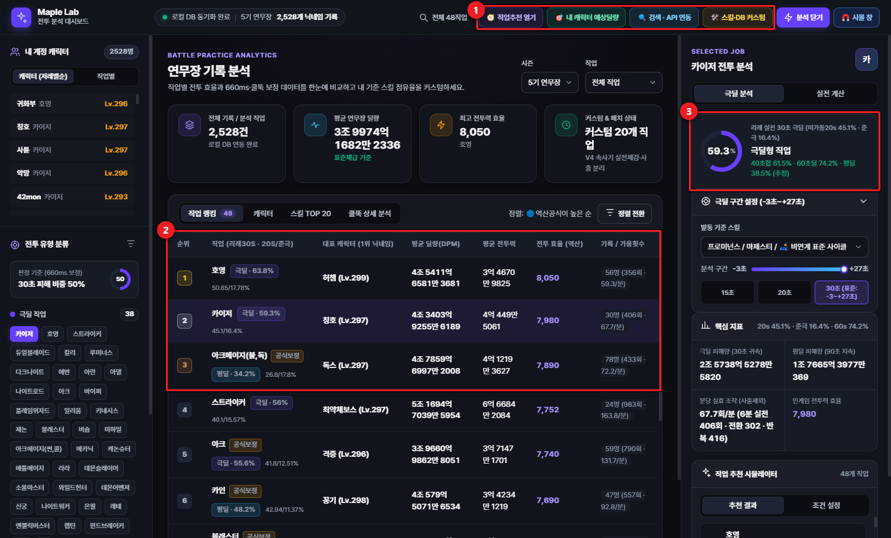
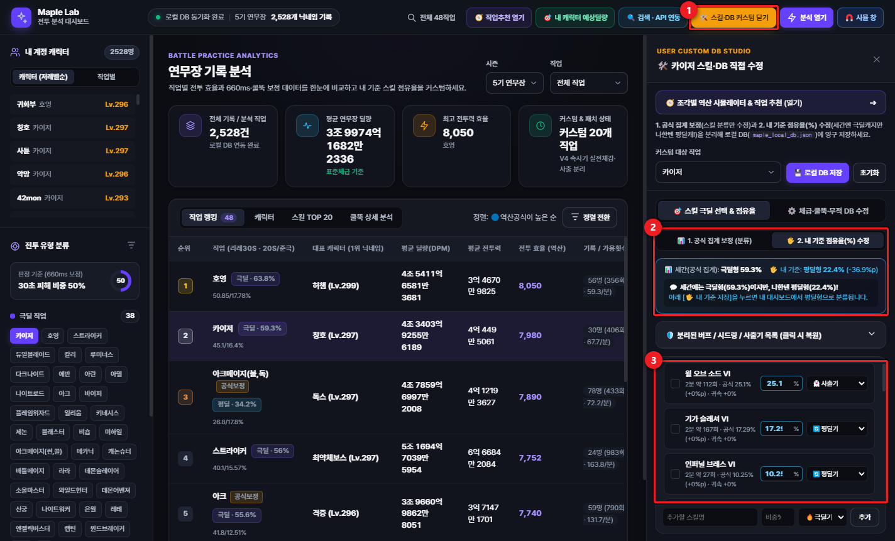
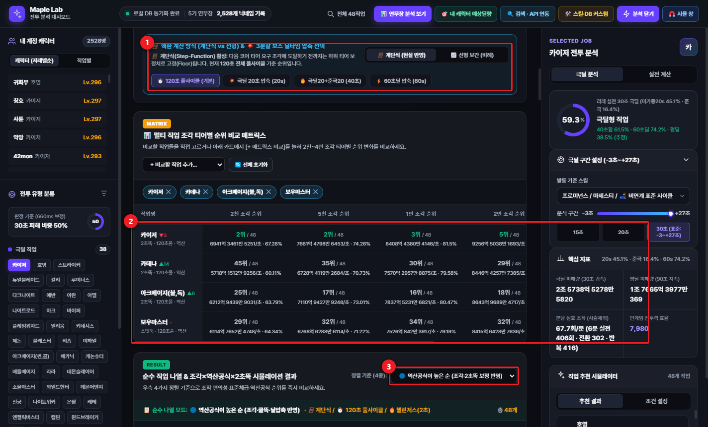
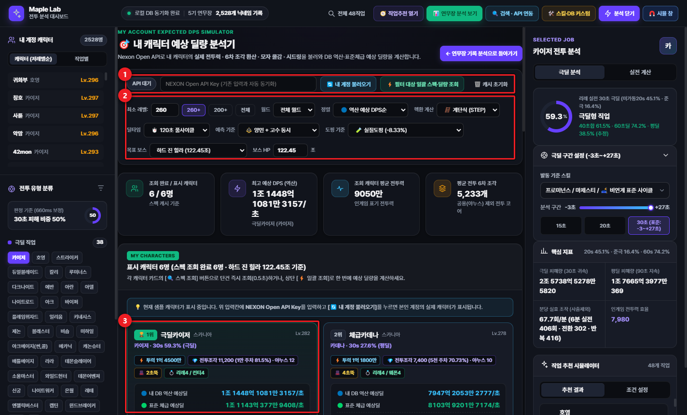
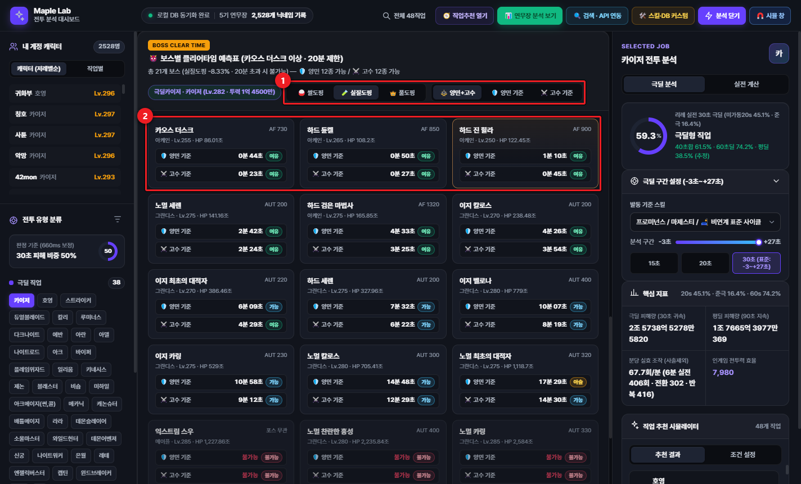
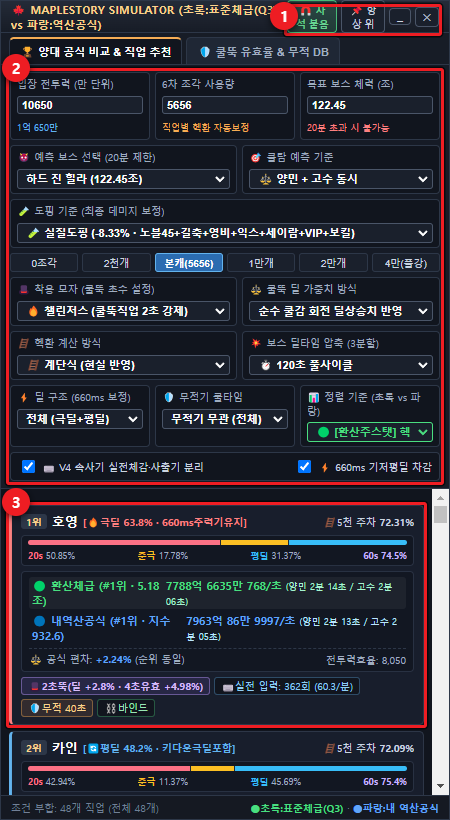

# 🍁 Maple Lab — 메이플스토리 연무장 분석 & 조각별 역산 시뮬레이터 (v1.2.0)

> 📌 **데이터 출처 (Credits)**  
> 본 프로그램에 반영된 조각 수준 별 헥환보정치 및 시드링 미가동 기준 딜량구간 점유율 데이터는 메이플스토리 인벤 **쿠제스** 님의 자료를 토대로 제작되었습니다.

---

## ⚡ 초간단 사용 방법 (1분 세팅)

1. 우측 **Releases**에서 최신 설치 파일 `TH_Setup_v1.2.0.exe` (OP.GG 스타일 원클릭 설치 · 약 `81.8 MB`)를 받아 바로 실행합니다.
   - 클릭 한 번으로 자동 설치되며 **바탕화면 바로가기** · **시작 메뉴 등록** 후 즉시 실행됩니다. (압축 해제·별도 DB 다운로드 불필요, 제거는 Windows **설정 → 앱 → 설치된 앱** 지원)
2. 🛡️ 최초 실행 시 `Windows의 PC 보호(SmartScreen)` 파란 경고창이 뜨면 **`[추가 정보] → [실행]`**을 눌러주세요.
3. 💡 **API 키를 안 넣어도 48직업 랭킹 · 스킬 점유율 커스텀 · 조각별 역산 · 비교 매트릭스는 바로 쓸 수 있습니다!**
4. 내 계정 캐릭터까지 연동하려면 [NEXON Open API](https://openapi.nexon.com/ko/) 사이트에 접속해 로그인합니다.
5. **`[애플리케이션 등록]`**에서 메이플스토리를 등록하고 API 키를 발급받습니다.
6. 프로그램 상단의 **`[🔍 검색 · API 연동]`** 또는 **`[🎯 내 캐릭터 예상딜량]`** 화면에서 API 키를 입력 → **`[계정 로드]`** 버튼을 누릅니다. *(API 키와 조회 캐시는 본인 PC 로컬에만 저장되며 외부로 유출되지 않습니다.)*
7. 이제 **`[🛠️ 스킬·DB 커스텀]`**, **`[🧭 직업추천 열기]`**, **`[🎯 내 캐릭터 예상딜량]`**에서 내 손에 맞게 스킬 점유율을 고치고, 내 캐릭터와 DB를 직접 비교하며 육성 직업과 보스 스펙을 시뮬레이션하면 끝!

---

## 🖼️ 한눈에 보는 주요 기능 가이드 (실제 화면)

### 1. 📊 48개 전 직업 연무장 분석 & V4 실전 조작감

- **① 상단 기능 메뉴**: **`[🧭 직업추천 열기]`**, **`[🎯 내 캐릭터 예상딜량]`**, **`[🔍 검색 · API 연동]`**, **`[🛠️ 스킬·DB 커스텀]`** 화면으로 즉시 이동합니다.
- **② 48직업 랭킹 & V4 실전 조작감**: 역산 효율(파랑)과 표준 체급(초록) 순위를 비교하고, 꾹 누름 압축 · 속사기 및 짧은 쿨타임 회전 보정(`⚡`) · 사출기 분리가 반영된 6분 실전 유효 조작 횟수와 분당 APM을 확인합니다.
- **③ 리레 실전 30초 극딜 & 3분할 비중**: 선택한 직업의 30초 극딜 귀속 비중과 20초 / 준극 20초 / 60초 / 평딜 구간 점유율을 실시간 그래프로 확인합니다.

---

### 2. 🛠️ 스킬 점유율 변경 & 2-트랙 DB 커스텀 스튜디오

**"세간에는 극딜 직업이라지만, 내 손에 맞게 점유율을 직접 바꿔서 시뮬레이션할 수 있습니다."**

- **① `[🛠️ 스킬·DB 커스텀]` 열기**: 상단 버튼을 누르면 우측 스튜디오 패널이 열리며 **`[💾 로컬 DB 저장]`**으로 내 PC에 영구 반영됩니다.
- **② 2-트랙 전환 & 세간 vs 내 기준 판정**:
  - **📊 `1. 공식 집계 보정 (분류)`**: 연무장 원본 점유율(%)은 유지한 채, 스킬별 극딜/평딜/버프/사출기 분류만 보정합니다.
  - **🖐️ `2. 내 기준 점유율(%) 수정`**: 예를 들어 극딜 비중을 낮춰 저장하면 **`"세간에는 극딜형(59.3%)이지만, 나한텐 평딜형(22.4%)!"`** 으로 자동 판정되어 대시보드 전체 분류와 추천 순위에 반영됩니다.
- **③ 스킬별 점유율(`%`) 직접 수정 · 신규 스킬 추가**: 각 스킬의 점유율(`%`)과 역할을 직접 입력해 수정하고, **`[⚖️ 100% 정규화]`** / **`[↩ 공식% 복원]`** / **`신규 스킬 추가`** 및 **`⚙️ 체급·쿨뚝·무적 DB 수정`**까지 모두 지원합니다.

---

### 3. 🧭 맞춤형 직업 추천 & 조각 티어별 비교 매트릭스

- **① 계단식/선형 헥환 · 3분할 딜타임 압축**: 현실 코어 주차를 반영한 **🪜 계단식(Step-Function)** vs **📈 선형 보간**을 고르고, **120초 풀사이클 / 극딜 20초 / 극딜+준극 40초 / 60초딜** 4가지 딜타임 모드를 즉시 전환합니다. *(표 미수록 5직업 나로·키네·카이저·불독·닼나는 `(추정)` 표시)*
- **② 2천~4만 조각 멀티 직업 순위 비교 매트릭스**: **`[+ 매트릭스 비교]`** 로 여러 직업을 담으면 **2천 / 5천 / 1만 / 2만 / 4만 조각** 티어별 48직업 내 순위 변화를 한 표에 비교합니다. *(챌린저스 2초뚝 강제 손실 자동 반영)*
- **③ 4종 정렬 기준**: 조작 적은 순(편한 직업) · 조작 많은 순 · 표준체급 순 · 역산공식 순으로 즉시 재정렬합니다.

---

### 4. 🎯 내 계정 캐릭터 예상 딜량 분석기 *(v1.2.0 NEW)*

- **① Nexon Open API Key 연동 · 일괄 스펙 조회**: API 키 입력 후 **`[🔄 내 계정 불러오기]`** → **`[⚡ 필터 대상 일괄 스펙·딜량 조회]`**(또는 카드별 단건 조회)를 실행합니다.
- **② 도핑 · 양민/고수 · 목표 보스 설정**: 최소 레벨(`260+` / `200+` / `전체`), 월드, 정렬, 헥환 방식, 딜타임, **3단계 도핑(`쌀도핑 -12.93%` · `실질도핑 -8.33%` · `풀도핑 0%`)** 및 목표 보스를 설정합니다.
- **③ 전투력·6차조각·쿨뚝·시드링 & 예상 DPS**: 야누스를 제외한 전투 6차 조각과 모자 쿨감 · 시드링을 자동 파싱해 **`🔵 내 DB 역산 예상딜`** 과 **`🟢 표준 체급 예상딜`** 을 나란히 계산합니다.

---

### 5. 👹 보스별 클리어타임 예측표 (카오스 더스크 이상) *(v1.2.0 NEW)*

- **① 3단계 도핑 & 양민/고수 전환**: **`🍚 쌀도핑 (-12.93%)`** · **`🧪 실질도핑 (-8.33%)`** · **`👑 풀도핑 (최고치 0%)`** 과 **🛡️ 양민 / ⚔️ 고수** 숙련도를 버튼 한 번에 전환합니다.
- **② 21개 보스 예상 클리어타임**: 선택한 캐릭터 스펙과 포스 배율 기준으로 카오스 더스크 ~ 노말 카링 21개 보스의 20분 컷 여유(`여유 / 가능 / 아슬 / 불가능`)를 자동 계산합니다.

---

### 6. 🧲 외부 자석 시뮬레이터 창 (`🧲 시뮬 창`)

- **① 자석 도킹 · 항상 위 고정**: 메인 창 우측 모서리에 자석처럼 붙거나(`🧲 자석 붙음`) 게임 화면 위에 띄워두는(`📌 항상 위`) 독립 창으로 동작합니다.
- **② 전투력 · 6차조각 · 도핑 · 2초뚝 설정**: 입장 전투력, 6차 조각, 목표 보스, **3단계 도핑(쌀/실질/풀도핑 0%)**, 쿨뚝 초수, V4 실전체감 옵션을 실시간 조절합니다.
- **③ 표준체급(초록) vs 역산(파랑) 실시간 비교**: 48직업의 **🟢 표준체급(Q3)** 과 **🔵 내 역산공식** 예상 딜량·클리어타임·공식 편차를 한 카드에서 비교합니다.

---

## 🧮 상세 계산 공식 및 실제 숫자 예시

### 예시 ① 🪜 계단식 vs 📈 선형 보간 헥환보정치 (입력: 5,000조각)
- **카이저** (2천: `67.28%` / `2,010개`, 5천: `74.26%` / `4,770개`): `5,000 ≥ 4,770`이므로 계단식에서도 5천 주차 통과 (`74.26%`)
- **히어로** (2천: `64.22%` / `1,979개`, 5천: `73.54%` / `5,004개`):
  - **🪜 계단식**: `5,000 < 5,004` (`4조각 부족`) → 2천 주차 고정 (`64.22%`) + `🔥 5천 주차까지 +4개!` 표시
  - **📈 선형 보간**:

$$64.22 + \frac{5{,}000 - 1{,}979}{5{,}004 - 1{,}979} \times (73.54 - 64.22) = 73.53\%$$

### 예시 ② 🎩 챌린저스 2초뚝 강제 손실 계산 (카데나: 본섭 4초뚝 → 챌린저스 2초뚝)
- **조건**: 주력기 평균 기본 쿨 `11.5초`, 쿨감 스킬 딜 비중 `58%`, 실가동률 계수 `0.88`, 메르세데스 유니온 `5%`
- 메르 5% 적용 기본 쿨타임: $11.5 \times 0.95 = 10.925\text{초}$
- 인게임 쿨감 공식 적용 (`10초 초과분 -1초`, `10초 이하분 초당 -5%`): **2초뚝 `9.46초`** / **4초뚝 `8.46초`**
- 순수 쿨감 딜 상승률 ($\text{Gain}$):

$$\text{Gain}(2\text{초뚝}) = 58\% \times \frac{10.925 - 9.46}{9.46} \times 0.88 = +7.90\%$$

$$\text{Gain}(4\text{초뚝}) = 58\% \times \frac{10.925 - 8.46}{8.46} \times 0.88 = +14.87\%$$

- 본섭 4초뚝 대비 챌린저스 2초뚝 상대 배율 ($\text{relMult}$):

$$\text{relMult} = \frac{1 + 0.0790}{1 + 0.1487} = 0.9393 \quad (-6.1\%)$$

*(반면 원래 스탯뚝 0초 직업인 히어로·보마·데슬 등은 `relMult = 1.000`, 손실 `0%`)*

### 예시 ③ 🔵 내 역산공식 vs 🟢 표준체급(Q3) 실전 DPS (카이저)
- **조건**: 전투력 `1억 650만`, 조각 `5,656개` (`5천 주차 74.26%`), 챌린저스 2초뚝 (`relMult = 0.944`), 목표 보스 `779조`
- **카이저 지표**: 표준체급 `4.940조` (히어로 `4.6907조`), 역산 효율 `7,914` (히어로 `7,138`), 4만 보정비 `99.42 / 98.39 = 1.0105`
- **🟢 표준체급 (Q3) 환산 지수 & 실전 DPS**:

$$\text{표준 지수} = 819.5 \times \frac{4.940}{4.6907} \times 1.0105 \times 0.944 = 823.3$$

$$\text{표준 실전 DPS} = 106{,}500{,}000 \times (823.3 \times 12) \times 0.7426 \times 0.70 \times 1.32 \approx 7{,}219\text{억/초}$$

- **🔵 내 역산공식 환산 지수 & 실전 DPS**:

$$\text{역산 지수} = 819.5 \times \frac{7{,}914}{7{,}138} \times 1.0105 \times 0.944 = 866.8$$

$$\text{역산 실전 DPS} = 106{,}500{,}000 \times (866.8 \times 12) \times 0.7426 \times 0.70 \times 1.32 \approx 7{,}601\text{억/초}$$

- `× 0.70`: 허수아비 대비 실전 보스 패턴 회피·이동 손실 계수 (`70%`)
- `× 1.32`: 아케인/어센틱 포스 우위 데미지 보너스 평균 배율 (`1.32배`)
- **목표 보스 779조 예상 클리어 시간**: 표준 **약 `17분 59초`** / 역산 **약 `17분 05초`**

### 예시 ④ 💥 3분할 보스 딜타임 압축 & 리레 실전 30초 환산 (카데나)
- **시드링 미가동 실측치 (인벤 쿠제스 님 자료 기준)**: 극딜 20초 = `51.11%`, 준극 20초(다음60쿨) = `15.59%`, 평딜 80초 = `33.30%`, 60초딜 = `78.72%`
- **리레(리스트레인트 링) 실전 30초 극딜 비중 환산** (리레 20초 배율 `1.38x` + 60초 잔여 10초분 `6.90%`):

$$\text{리레 실전 30초 비중} = \frac{(51.11 \times 1.38) + 6.90}{(51.11 \times 1.38) + (100 - 51.11)} \times 100 = 64.8\%$$

- **보스 딜타임 20초 압축 모드 (`BURST_20`)**:

$$\text{20초 순간 화력 배율} = 0.5111 \times \frac{120}{20} = 3.067\text{배}$$

- 120초 평균 실전 DPS가 `7,000억/초`라면, 20초 극딜 누적 딜량은 **약 `42조 9,324억` (초당 `2조 1,466억/초`)**으로 산출됩니다.

---

## 📄 Disclaimer & Credits

- **데이터 출처**: 조각 수준 별 헥환보정치 및 시드링 미가동 딜량구간 점유율 자료 — **메이플스토리 인벤 쿠제스 님**
- This application is not associated with NEXON Korea. Data based on NEXON Open API.
- **Distributed via Releases Only** · **Author**: `sauron147` · **Version**: `v1.2.0`
